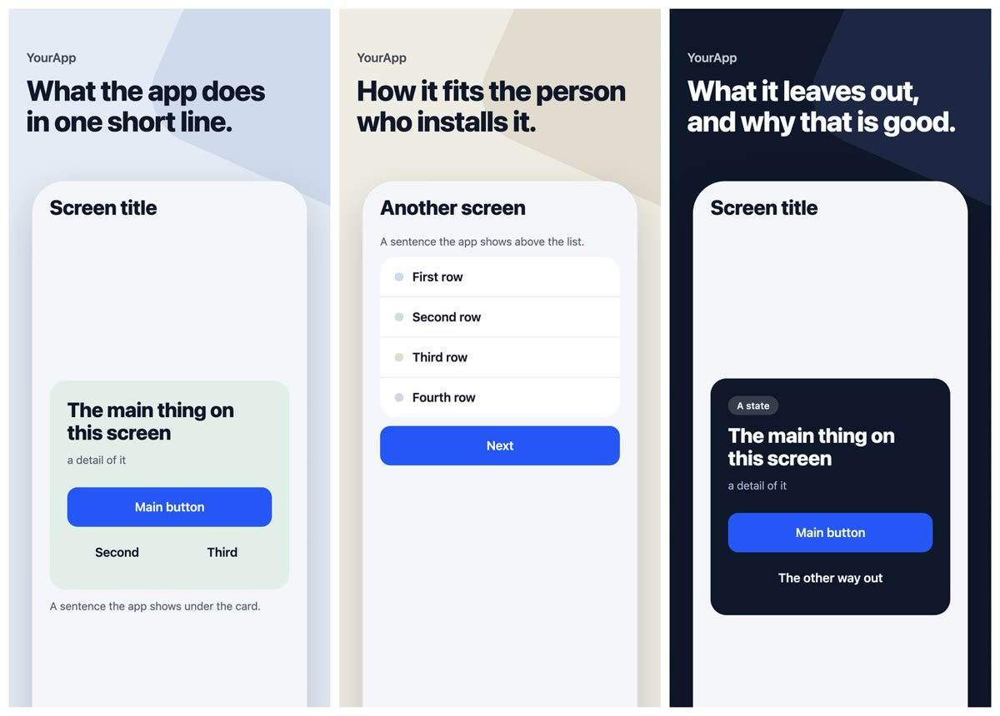
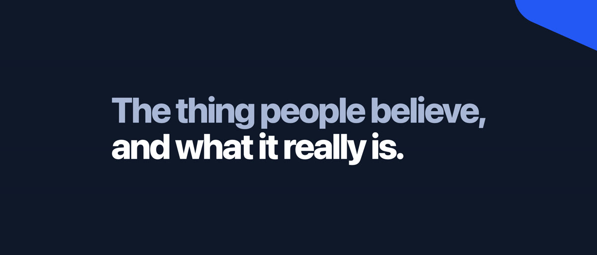
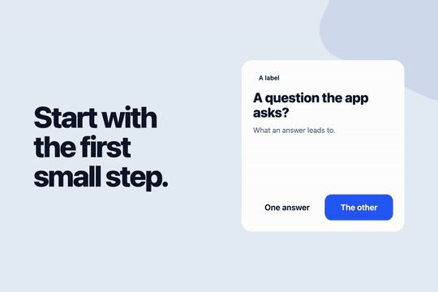

<p align="center"></p>

# appstoreconnect-setup

A [Claude Code](https://claude.com/claude-code) skill that takes an app from nothing to a complete App Store product
page, step by step, with you deciding at every stage.

It designs your screenshots, your product page header and your search-results video **from your own design system**,
writes the store texts with you, runs a translator and a separate auditor for every language, fills App Store Connect
in the browser, and hands you a checklist for the one thing you do by hand: uploading the files.



<p>
  
  
</p>

*The pictures above are the skill's placeholders. Yours are drawn from your app's colours, type and components; the
skill ships no look of its own.*

## What it does

| # | Stage | You get |
|---|---|---|
| 1 | **discover** | Claude reads your repository and your Claude Design project: what the product is, how it speaks, whether it has a design system |
| 2 | **frames** | screenshots: a claim over a drawn screen of your app, proposed on a new page in Claude Design, iterated, then rendered locally |
| 3 | **header** | the 21:9 product page header, from your kit |
| 4 | **video** | the looping search-results video; describe the scenes and the motion in words and it is built that way |
| 5 | **listing** | name, subtitle, promotional text, keywords, description and TestFlight texts, settled in your main language |
| 6 | **languages** | you choose the languages; each gets a translator agent and a separate auditor agent, then every picture is rendered and checked for fit |
| 7 | **connect** | App Store Connect filled in field by field, in every language, with a ledger of what is entered where |
| 8 | **upload** | a per-language checklist for uploading the pictures and the video yourself |

Run it again any time: it keeps its place in `store/PROGRESS.md`.

How long it takes depends on you: how many rounds of changes you ask for and how many languages you choose. The
generating, rendering and filling in are the short part.

## The idea

Every picture is rendered from **one template and one text file per language**. A word is corrected in a JSON file
and rendered again, never in a picture.

```
store/
  store.config.json          the app's name, languages, where the kit is, sizes
  kit/                       your design system's CSS (tokens, components)
  frames/template/*.html     one frame each, {{fields}} in place of texts
  frames/texts/<lang>.json   every string of one language
  header/  video/            the same, for the header and the video
  listing/<lang>.json        subtitle, promotional text, keywords, description
  out/<lang>/                frame-1.png …, header.png, search-video.mp4
  approved/<lang>/           the copies you approved; later renders are compared with them
```

So twenty languages are twenty small files, and the renderer tells you which claim is three pixels too wide in
German. A few more things it insists on:

- **The screens show your app.** Screens are drawn from your kit, so every word on them is checked against your
  app's own texts in that language.
- **Right to left is mirrored**, and Japanese, Korean, Chinese and Arabic get their own faces and line breaking.
- **An approved picture is never painted over.** Later renders are compared with it, pixel for pixel.
- **No language ships on one agent's word.** A translator writes it, a different agent audits it, and keywords are
  chosen for what people in that country type, not translated.

## Requirements

- Claude Code with a browser it can drive (the desktop app's browser pane, or Claude in Chrome)
- Node 18 or newer, Python 3, and `ffmpeg` for the video
- An Apple Developer account with the app's record created in App Store Connect (for stage 7)
- A [Claude Design](https://claude.ai/design) project is recommended, not required: without one the skill writes the
  templates directly and you iterate on the rendered pictures

## Install

Copy the skill's folder into your project:

```bash
git clone --depth 1 https://github.com/wojdan/appstoreconnect-setup.git /tmp/appstoreconnect-setup
```

```bash
mkdir -p .claude/skills && cp -R /tmp/appstoreconnect-setup/appstoreconnect-setup .claude/skills/
```

Then, in Claude Code, in your project:

```
/appstoreconnect-setup
```

On the first run it asks before installing its renderers' dependencies (Playwright with Chromium, and `sharp`).

To have it in every project instead, copy it to `~/.claude/skills/`. The project's copy is the better default: the
rules you add to `SKILL.md` are that project's own.

To update, delete `/tmp/appstoreconnect-setup` and run both commands again. That replaces `SKILL.md`, so keep a copy
of the rules you added at its bottom, or commit the skill and let git show you the difference.

## Using it

```
/appstoreconnect-setup            continue where it stopped
/appstoreconnect-setup status     where things stand
/appstoreconnect-setup video      go to a stage: discover, frames, header, video, listing, languages, connect, upload
```

What it asks of you:

- to open your Claude Design project in the session's browser, and later to **sign in to App Store Connect yourself**
  in the same browser; it never types a password or a code;
- a decision at the end of every stage; nothing is translated before you have approved it in your main language;
- music for the video, if you want any. Take a **CC0** track (public domain, nothing to attribute, nothing that can be
  withdrawn): [FreePD](https://freepd.com), [Freesound](https://freesound.org) with the CC0 filter,
  [OpenGameArt](https://opengameart.org), [Free Music Archive](https://freemusicarchive.org) with the CC0 filter.
  The store plays search-results videos muted anyway.

### Describe your video in words

> "Three scenes. First the question the app asks, on our dark background. Then the answer slides up from the bottom
> and the text types itself out. End on the icon, hold it for a second, loop."

The default scenario (four scenes, text on one side, a card that flips on the other, seamless loop) is one file of
JSON and one of motion; say what you want instead and the skill rewrites them and renders a sample.

## What it will not do

- submit anything to Apple, publish your App Privacy answers, or press any button that does
- touch another app, your agreements, banking, or users in App Store Connect
- sign in for you, or upload the pictures (it prepares the checklist; the upload is yours)
- invent a look: backgrounds, colours and type come from your design system or it stops and asks

## Make it yours

The skill is plain Markdown and a few hundred lines of JavaScript and Python. Your project's facts live in
`store/store.config.json`; your standing rules (tone, words you never use, how many frames, which languages) go at the
bottom of `SKILL.md`, where they override everything else. The pages in `reference/` are one per stage; change the one
you disagree with.

The tools also work without Claude:

```bash
node .claude/skills/appstoreconnect-setup/tools/render-frames.mjs de
```

## Honest limits

- Sizes, limits and App Store Connect's pages are described as they were in **October 2026**. Apple changes them; the
  skill is told to check Apple's specification pages before the first render.
- Bringing a page out of Claude Design uses the page's own internal interface, which may change; the fallback is
  downloading the files yourself.
- Translators and auditors are models. Before a market matters to you, have a native speaker read that language.
- Apple publishes no safe areas for the header and the video. The numbers here were measured in App Store Connect's
  preview; yours is the preview you look at after uploading.

## License

MIT. See [LICENSE](LICENSE).
